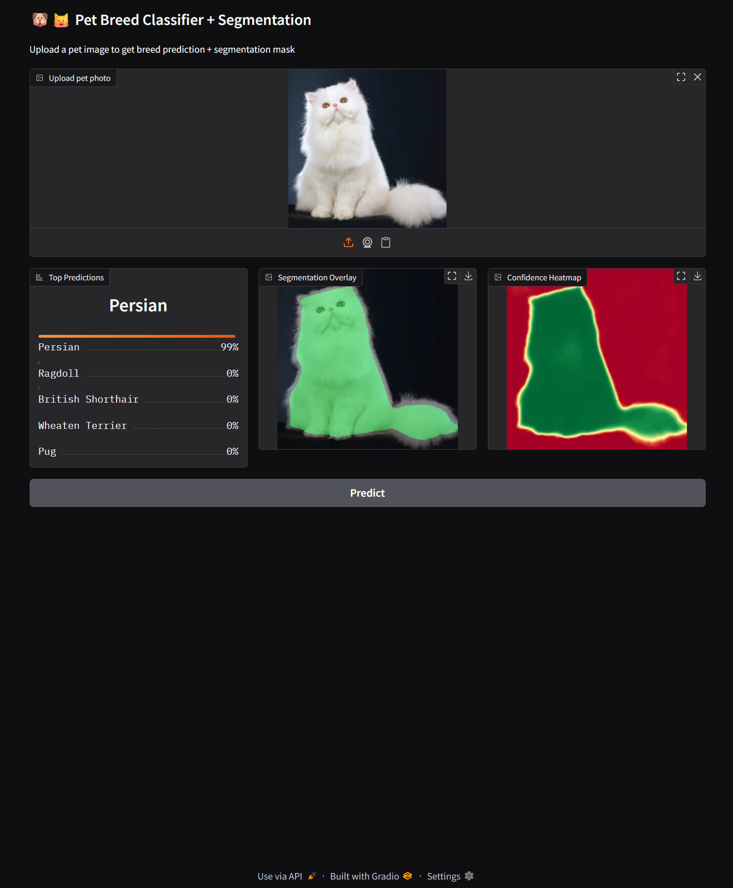

# Cat and Dog Breed Classification and Segmentation Using EfficientNet and UNet++

## Overview

Cat and Dog Breed Classification and Segmentation Using EfficientNet and UNet++ is a deep learning-based computer vision project designed to classify cat and dog breeds and generate pixel-level segmentation masks from pet images. The system combines transfer learning with **EfficientNet-B0** for classification and **UNet++ with an EfficientNet-B2 encoder** for segmentation to improve prediction quality, preserve fine visual details, and deliver a practical end-to-end inference workflow.

The project is built for research, academic presentation, and portfolio demonstration. It includes model training, validation, visual evaluation, checkpoint saving, and an interactive **Gradio** interface for real-time inference.

---

## Key Highlights

- End-to-end pet breed classification and segmentation pipeline
- Transfer learning with **EfficientNet-B0** for breed classification
- Fine-tuning phase for improved performance
- **UNet++** with **EfficientNet-B2** encoder for binary pet segmentation
- Advanced image augmentation for better generalization
- Mixed precision training for efficient GPU usage
- Early stopping and best checkpoint saving
- Comprehensive evaluation using accuracy, precision, recall, F1-score, IoU, and Dice score
- Confusion matrix and per-class accuracy analysis
- Gradio-based interactive inference interface
- Result preview included in `Results.png`

---

## Project Architecture

### Training Workflow

The project follows a structured machine learning lifecycle:

1. Environment check
2. Google Drive mounting
3. Dataset extraction from compressed archives
4. Breed label extraction from image filenames
5. Train/validation split for classification
6. Classification dataset and dataloader creation
7. EfficientNet-B0 initialization
8. Frozen-backbone classification training
9. Fine-tuning of the full classifier
10. Final classification evaluation
11. Segmentation dataset preparation
12. Trimap-to-binary mask conversion
13. UNet++ initialization with EfficientNet-B2 encoder
14. Segmentation training with combined loss
15. Segmentation validation and checkpoint saving
16. Prediction visualization
17. Gradio app construction for inference

Generated model artifacts:

- `best_model.pth` — Best classification checkpoint
- `best_seg_model.pth` — Best segmentation checkpoint

This structure cleanly separates classification, segmentation, and inference stages.

---

## Dataset

This project uses the **Oxford-IIIT Pet Dataset**.

### Dataset Description

- Cat and dog breed images
- Breed-level labels embedded in image filenames
- Segmentation annotations available as trimaps
- Suitable for both classification and segmentation tasks

### Dataset Structure

- `images/` — pet images
- `annotations/trimaps/` — segmentation masks

### Segmentation Mask Logic

The trimap masks are converted into binary masks where:

- `1` = pet region
- `0` = background or uncertain region

This allows the segmentation model to learn a clean binary foreground extraction task.

---

## Machine Learning Methodology

### Data Preparation

The pipeline extracts the dataset from nested archives and builds the training input directly from the file structure. For classification, labels are derived from filenames by removing the trailing numerical suffix.

For segmentation, each image is paired with its corresponding trimap annotation, and the mask is converted to binary format.

### Classification Split Strategy

The classification dataset is split randomly into:

- **Training set:** 80%
- **Validation set:** 20%

This split is implemented using PyTorch `random_split`.

### Segmentation Split Strategy

For segmentation, image files are split using `train_test_split` with:

- **Training set:** 80%
- **Validation set:** 20%
- `random_state=42` for reproducibility

### Data Augmentation

#### Classification Augmentation
The classification pipeline uses:

- Resize
- Random resized crop
- Horizontal flip
- Rotation
- Color jitter
- Random grayscale
- Normalization

#### Segmentation Augmentation
The segmentation pipeline uses:

- Resize
- Horizontal flip
- Affine transformation
- Color jitter
- Noise or blur
- Grid distortion
- Normalization

These augmentations improve generalization and reduce overfitting.

---

## Model Architecture

### Classification Model

The classification component uses **EfficientNet-B0** pretrained on ImageNet.

#### Architecture Components

- Input image preprocessing
- EfficientNet-B0 backbone
- Batch normalization
- Dropout regularization
- Fully connected output layer for breed classification

#### Why This Design Works

- EfficientNet-B0 provides strong feature extraction with efficient parameter usage
- Freezing the backbone first allows stable transfer learning
- Fine-tuning later adapts the model to pet breed-specific patterns
- Label smoothing improves training robustness

### Segmentation Model

The segmentation component uses **UNet++** with an **EfficientNet-B2** encoder.

#### Architecture Components

- EfficientNet-B2 encoder pretrained on ImageNet
- UNet++ decoder with nested skip connections
- SCSE attention in decoder blocks
- Binary output layer for pet mask prediction

#### Why This Design Works

- UNet++ improves feature fusion through dense skip connections
- EfficientNet-B2 provides a strong encoder while remaining lightweight
- SCSE attention improves feature refinement
- The architecture is well suited for fine pet boundary segmentation

---

## Training Strategy

### Phase 1: Classification Training

- EfficientNet-B0 backbone is frozen
- Only the classifier head is trained initially
- Optimizer: AdamW
- Learning rate: `2e-4`
- Loss: CrossEntropyLoss with label smoothing
- Scheduler: CosineAnnealingLR
- Best model saved as `best_model.pth`

### Phase 2: Classification Fine-Tuning

- Entire model is unfrozen
- Learning rate is reduced to `5e-5`
- Training continues with early stopping
- Best updated checkpoint is saved again if validation improves

### Segmentation Training

- UNet++ is trained on binary masks
- Loss is a weighted combination of:
  - Tversky Loss
  - Focal Loss
- Optimizer: AdamW
- Learning rate: `3e-4`
- Scheduler: Linear warmup followed by cosine decay
- Gradient clipping is used for stability
- Best model saved as `best_seg_model.pth`

---

## Training Configuration

| Parameter | Classification | Segmentation |
| --- | --- | --- |
| Input Image Size | 256 × 256 / 300 × 300 | 256 × 256 |
| Batch Size | 32 | 16 |
| Backbone / Encoder | EfficientNet-B0 | EfficientNet-B2 |
| Optimizer | AdamW | AdamW |
| Initial Learning Rate | 2e-4 | 3e-4 |
| Fine-Tuning Learning Rate | 5e-5 | - |
| Loss Function | CrossEntropyLoss | Tversky + Focal Loss |
| Scheduler | CosineAnnealingLR | Warmup + Cosine Annealing |
| Precision | Mixed Precision | Mixed Precision |
| Checkpoint File | `best_model.pth` | `best_seg_model.pth` |

---

## Evaluation

The project includes detailed evaluation for both tasks.

### Classification Evaluation

- Accuracy
- Precision
- Recall
- F1-score
- Classification report
- Confusion matrix
- Per-class accuracy analysis

### Segmentation Evaluation

- IoU
- Dice score
- Accuracy
- Precision
- Recall
- Validation loss tracking
- Visual mask prediction analysis

### Visual Output

The repository includes a sample result image:



This file provides a visual snapshot of the final project output.

---

## Inference Workflow

The final inference pipeline performs the following:

1. Loads the trained classification model
2. Loads the trained segmentation model
3. Accepts a pet image as input
4. Predicts the top breed classes
5. Generates a segmentation mask
6. Creates an overlay visualization
7. Produces a confidence heatmap
8. Displays everything in a Gradio interface

### Inference Outputs

- Top-5 breed predictions
- Segmentation overlay
- Heatmap visualization

---

## Installation

### Clone the Repository

```bash
git clone https://github.com/sushantkothari/Cat-and-Dog-Breed-Classification-and-Segmentation-Using-EfficientNet-and-UNetPlusPlus.git
cd Cat-and-Dog-Breed-Classification-and-Segmentation-Using-EfficientNet-and-UNetPlusPlus
